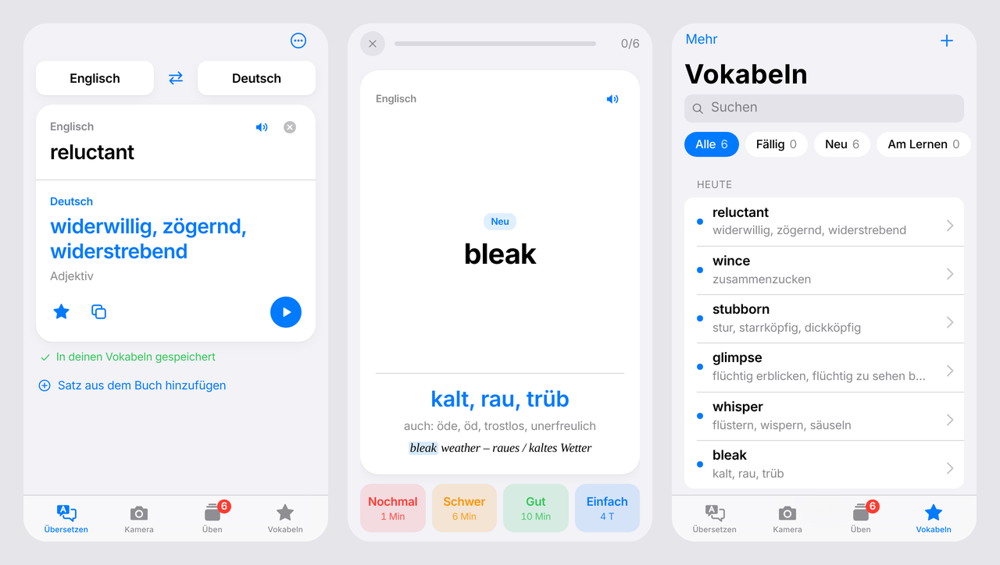

# Vokabel-Übersetzer

Englische Bücher lesen und die Vokabeln dabei gleich lernen. Die App sieht aus und funktioniert wie der
Apple-Übersetzer, speichert aber jedes nachgeschlagene Wort automatisch und fragt es später mit
Karteikarten nach einem Wiederholungsplan ab.

**App öffnen:** https://karlos-ai.github.io/book-translater/
(auf dem iPhone in Safari öffnen → Teilen → „Zum Home-Bildschirm“)



## Funktionen

- **Übersetzen** – Englisch ⇄ Deutsch schon beim Tippen. Wörter kommen sofort aus dem eingebauten
  Wörterbuch, auch offline: Bedeutungen nach Wortart, Nomen mit Artikel, Wendungen und die Grundform
  (*glimpsed → glimpse*, *ran → run*). Ganze Sätze übersetzt ein Online-Dienst.
- **Automatisch speichern** – Wörter und kurze Wendungen landen in der Vokabelliste, auf Wunsch mit dem
  Satz aus dem Buch. Wer ein Wort erneut nachschlägt, bekommt es sofort wieder zum Üben.
- **Buchseite** – einen Absatz einfügen und unbekannte Wörter direkt antippen; der Satz wird als Kontext
  gespeichert.
- **Üben** – Karteikarten (Nochmal / Schwer / Gut / Einfach), Schreiben mit Tippfehler-Erkennung und
  Multiple Choice, in beide Richtungen. Wiederholungsplan nach SM-2, Tagesziel und Serie.
- **Vokabeln** – Suche, Filter nach Lernstand, Bearbeiten, Export als JSON-Backup oder CSV (z. B. für Anki).
- Aussprache, Hell- und Dunkelmodus, offline nutzbar, keine Anmeldung. Die Daten bleiben auf dem Gerät.

## Aufbau

Die ganze App ist eine einzige Datei ohne Abhängigkeiten: [`src/app.html`](src/app.html).

| Pfad | Inhalt |
| --- | --- |
| `src/app.html` | App (HTML, CSS, JavaScript) |
| `src/core-en.json.gz` | Grundwortschatz (~76.000 Wörter), wird in die Seite eingebettet |
| `docs/` | fertige Web-App für GitHub Pages: Seite, Manifest, Service Worker, Icons, Wörterbuch in Teildateien |
| `tools/build.mjs` | baut `docs/` aus `src/` |
| `tools/build_dict.py` | erzeugt das Wörterbuch aus den Ding-Daten |
| `tools/icons.cjs` | rendert die App-Icons |

```sh
python3 tools/build_dict.py <pfad>/de-en   # Wörterbuch (Ding aus dem Ubuntu-Paket trans-de-en; pip install wordfreq)
node tools/build.mjs                       # docs/ neu bauen
```

Die Seite wird von GitHub Pages aus `docs/` auf `main` ausgeliefert.

## Wörterbuch

Die Wörterbuchdaten stammen aus **Ding** (Englisch–Deutsch, © Frank Richter, TU Chemnitz,
<https://dict.tu-chemnitz.de/>), lizenziert unter der GNU GPL Version 2 oder später.
`tools/build_dict.py` sortiert die Bedeutungen (Alltagsbedeutungen vor Fachsprache, Slang und Regionalem,
Worthäufigkeit über [wordfreq](https://github.com/rspeer/wordfreq)), ordnet gebeugte Formen ihrer
Grundform zu und teilt alles in kleine Dateien, von denen die App nur die gerade benötigte lädt.
